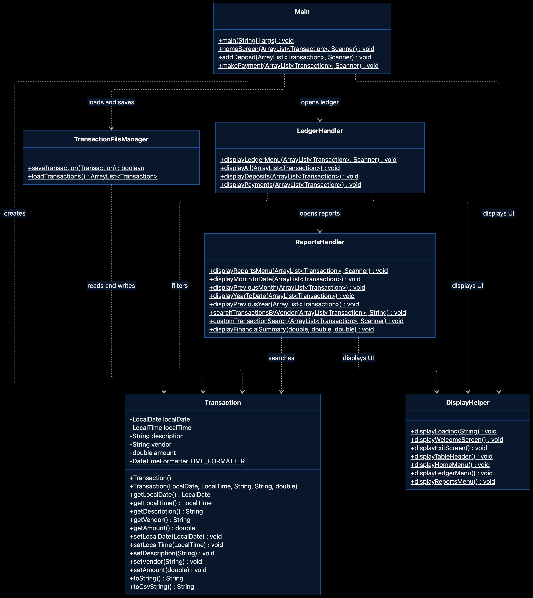
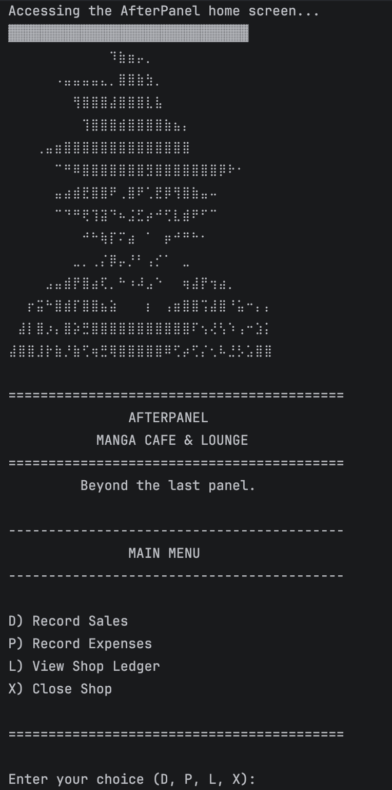
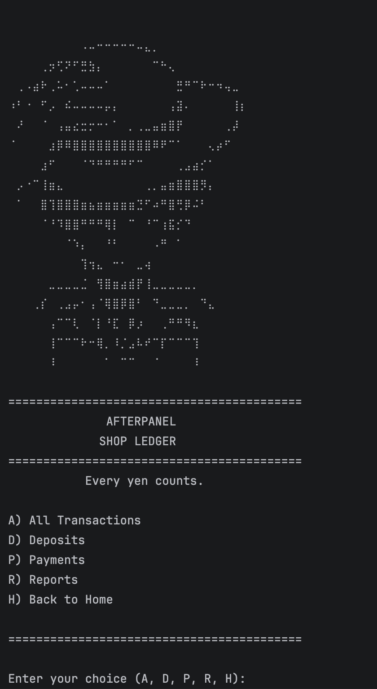
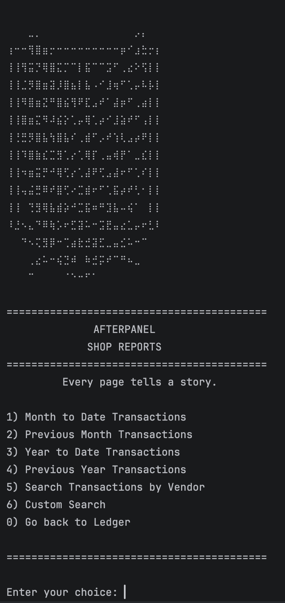
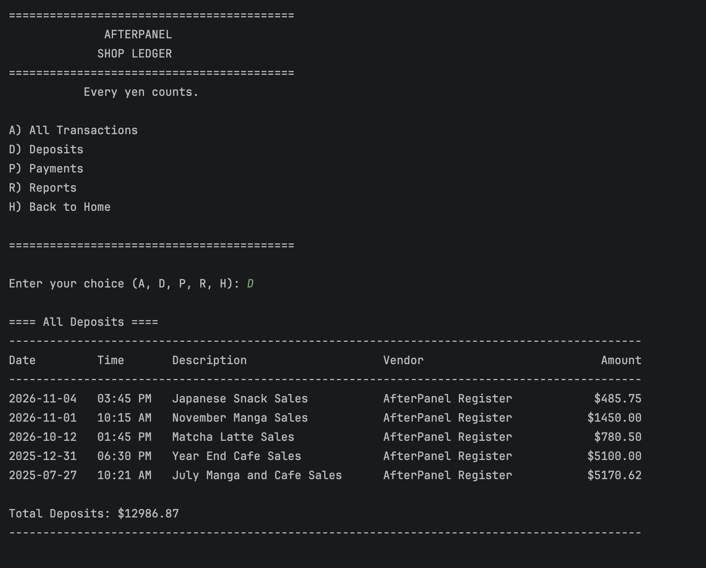
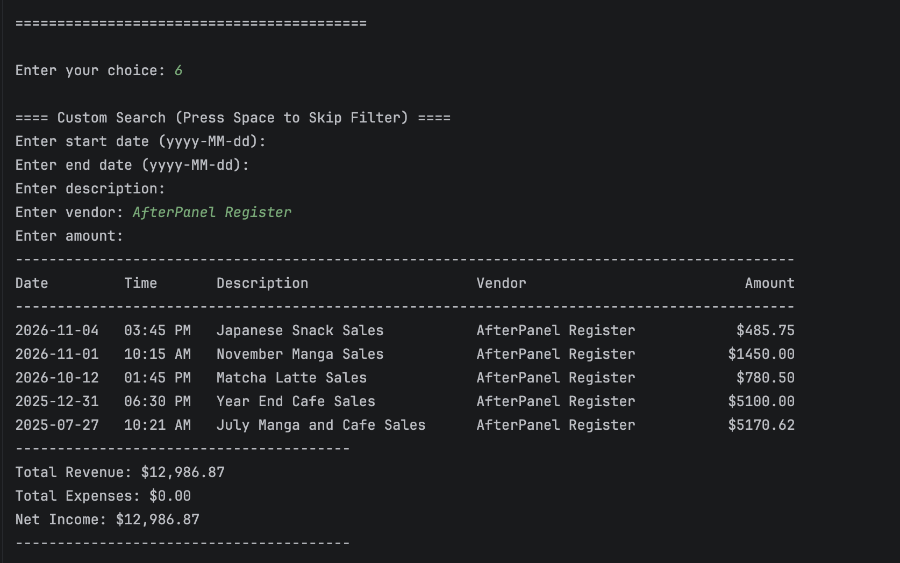
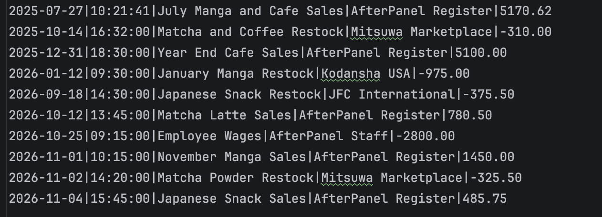

# AfterPanel Manga Cafe & Lounge

> Capstone 1: Accounting Ledger Application  
> Year Up United | Technical Academy Fall 2026

## Description
AfterPanel Manga Cafe & Lounge is an accounting ledger app built in Java for a fictional manga café. This program lets users record deposits and payments, keep track of financial activity, and review past transactions through a simple command-line interface.

Each transaction stores the date, time, description, vendor, and amount, and is saved into a `transactions.csv` file so the data can be loaded again when the program starts.

To match the café theme, I also customized the project with ASCII art, loading animations, and formatted transaction tables. I also added separate ledger views, report filters, and a custom search feature.

---

## Interesting Piece of Code
One part of the project I found interesting was **sorting transactions from newest to oldest** in `TransactionFileManager.java`. When transactions are loaded from the CSV file, I use Java's `Comparator.comparing()` to sort by date and `thenComparing()` to sort by time when two transactions share the same date. By default, this sorts from oldest to newest, so I added `reversed()` to display the most recent transactions first.

```java
// Sort transactions by date and time, newest first.
transactionsList.sort(Comparator.comparing(Transaction::getLocalDate)
        .thenComparing(Transaction::getLocalTime)
        .reversed());
```

This keeps the ledger organized without requiring users to manually sort entries. It also gave me practice using method references and chaining comparators to control how objects are ordered.

---

## UML Diagram



---

## File Structure
```text
src/main/java/com/pluralsight/
├── Main.java
├── Transaction.java
├── TransactionFileManager.java
├── LedgerHandler.java
├── ReportsHandler.java
└── DisplayHelper.java
transactions.csv
README.md
```

---

## Screenshots

### Home Screen


### Ledger Screen


### Reports Screen


### Display Example (Deposits)


### Reports (Custom Search)


### CSV File Example
